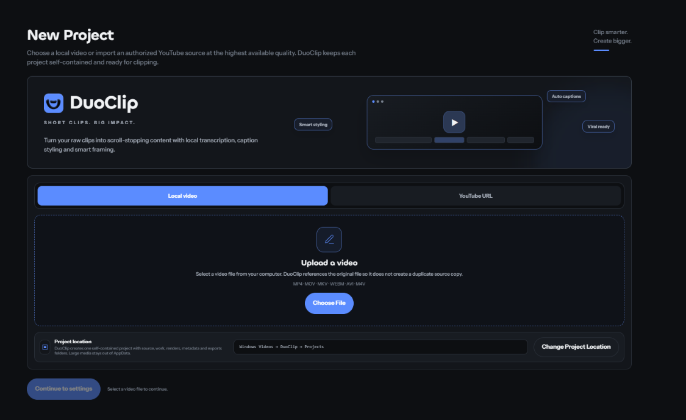
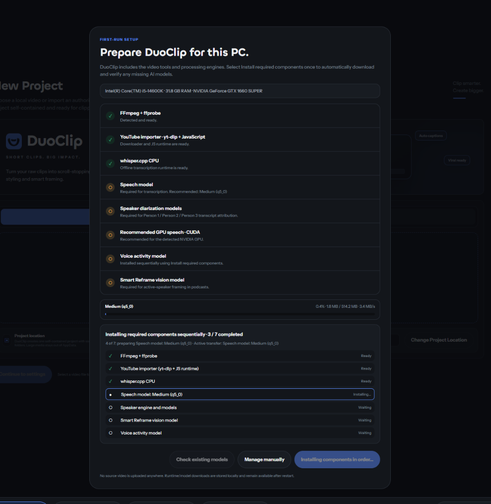
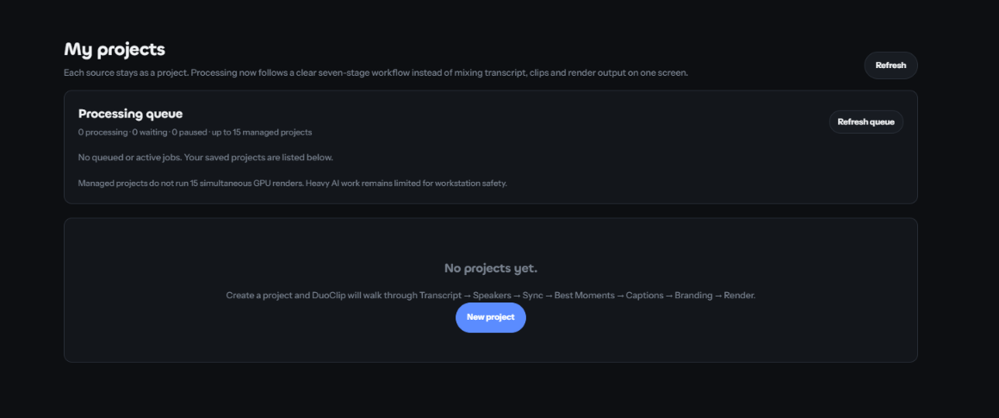
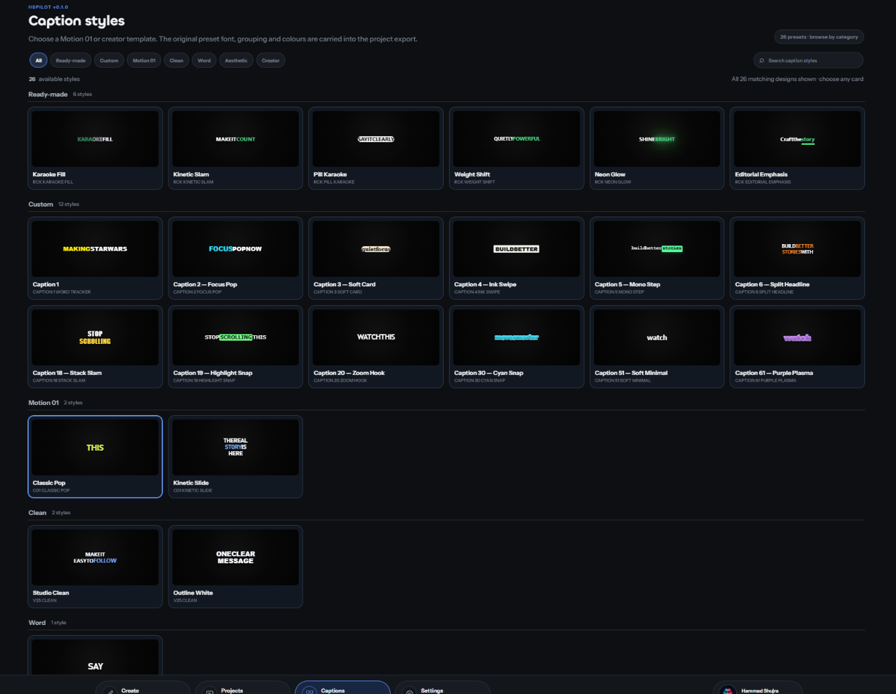
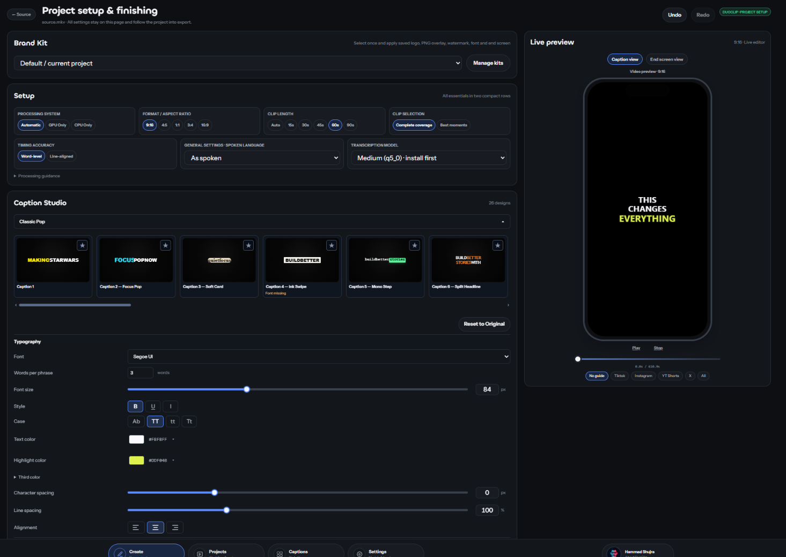
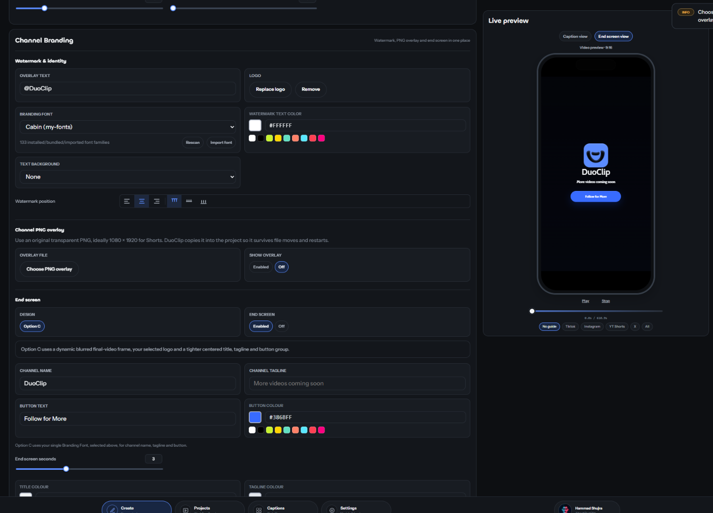
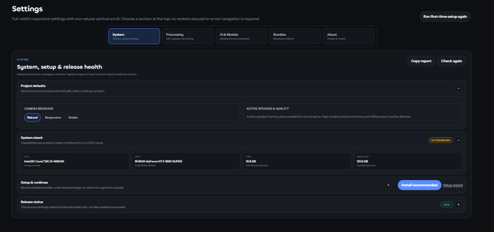

  

<h1 align="center">DuoClip</h1>

<strong>Turn long videos into short, creator-ready clips.</strong>

  A free, local-first AI video clipping studio for Windows. 
  Import footage, set up clips, style captions, add your branding, and prepare videos for export.

  <a href="https://github.com/hammadshujra/DuoClip/releases"><strong>⬇ Download for Windows</strong></a>
  &nbsp;·&nbsp;
  <a href="#explore-duoclip">Explore the app</a>
  &nbsp;·&nbsp;
  <a href="#getting-started">Getting started</a>
  &nbsp;·&nbsp;
  <a href="https://github.com/hammadshujra/DuoClip/issues">Feedback</a>

Windows 10 / 11 (64-bit) &nbsp;•&nbsp; Free download &nbsp;•&nbsp; Local-first workflow

---

## Meet DuoClip

**DuoClip** brings the important steps of short-form video creation into a single Windows desktop workspace. Start with a local video or an authorized online source, configure how clips should be prepared, choose from **26 caption designs**, and personalize the result with a watermark, channel branding, and an end screen.

DuoClip is built around a **local-first workflow**: supported video processing runs on your PC. Some AI models and processing tools need to be downloaded during first-run setup, and importing videos from online sources requires internet access.

### What you can do

| | |
| :--- | :--- |
| **Import videos** — Start from a file on your PC or a supported YouTube URL. | **Shape your clips** — Configure vertical aspect ratios, clip duration, and processing preferences. |
| **Work with AI tools** — Use supported transcription, speaker, and smart reframing components. | **Style every caption** — Explore 26 designs and adjust typography, colors, and layout. |
| **Make it yours** — Add watermark text, a logo, channel identity, and a branded end screen. | **Manage your work** — Organize projects, check the processing queue, and preview your settings. |

---

## Explore DuoClip

Real screenshots from the DuoClip Windows application. Images have been cropped to make the controls easier to see.

### 01 · New Project — import your video

**Start your next clip in one place.** Choose **Local video** to select a file from your computer, or switch to **YouTube URL** for a source you have permission to use. Set the project storage location and continue into the editing workflow.

### 02 · First-Run Setup — prepare your PC

**Know what's ready before you begin.** DuoClip checks its processing tools and displays the status of items such as FFmpeg, the YouTube importer, speech models, speaker diarization, and smart reframing models. Download missing components and follow their progress in the setup window.

### 03 · My Projects — stay organized

**Keep your workflows together.** The Projects screen provides a home for saved projects and shows processing queue activity. Start another project or return to an existing one as your library grows.

### 04 · Caption Styles — choose your look

**Find a style that fits your video.** Browse **26 caption designs** organized into categories, including ready-made, custom, motion-inspired, clean, and word-based looks. The preview cards let you compare styles before selecting one for a project.

### 05 · Project Setup — customize your clips

**Control the result before exporting.** Choose the processing mode, aspect ratio, clip length, transcription settings, and caption design. Adjust text appearance while checking the **9:16 live preview** on the right.

### 06 · Channel Branding — leave your signature

**Keep your channel identity consistent.** Set watermark text and position, choose a branding font, add a logo or transparent PNG overlay, and customize the end screen with a channel name, tagline, button text, and colors.

### 07 · Settings — inspect your system

**Check the environment your projects run on.** Review the detected CPU, GPU, memory, processing options, and runtime status. Use the setup controls to check installed components or manage required tools when needed.

---

## How it works

1. **Create a project** — Choose a local video or supported video URL.
2. **Configure your clips** — Set output format, duration, and processing preferences.
3. **Prepare AI components** — Check or install the models your chosen workflow needs.
4. **Style captions** — Pick a preset and adjust text appearance.
5. **Add branding** — Customize watermark, logo, and end-screen settings.
6. **Preview and export** — Review the project and render using the available processing components.

> **Local-first, not necessarily offline from the start.** Video files and supported processing workflows are handled on your PC. Initial component/model downloads, some checks, and online video imports may use the internet. Performance and available features depend on your hardware and installed models.

## Getting started

1. Open the [**DuoClip Releases**](https://github.com/hammadshujra/DuoClip/releases) page.
2. When an installer is published, download `DuoClip-Setup-0.1.0.exe` (or the latest version shown under **Assets**).
3. Run the installer, then open DuoClip from your desktop or Start menu.
4. Complete the first-run component checks and install any missing processing tools or models.
5. Start a new project and import a video to begin.

**System compatibility:** Windows 10 or Windows 11, 64-bit. A modern processor and enough free disk space for footage, models, and temporary files are recommended; a compatible GPU may accelerate supported tasks. Final minimum hardware requirements are still being validated.

**Release note:** DuoClip is currently in the `0.1.0` development release series. Installer downloads will appear on the Releases page once a build is ready to share. Some features and configurations are still being tested.

## Feedback

Have a suggestion or found something that isn't working? [**Open an issue**](https://github.com/hammadshujra/DuoClip/issues) and include the DuoClip version, your Windows version, and the steps to reproduce the behavior. Please avoid posting private video files, access tokens, or personal information.

---

<strong>DuoClip</strong> Short clips. Big impact.

